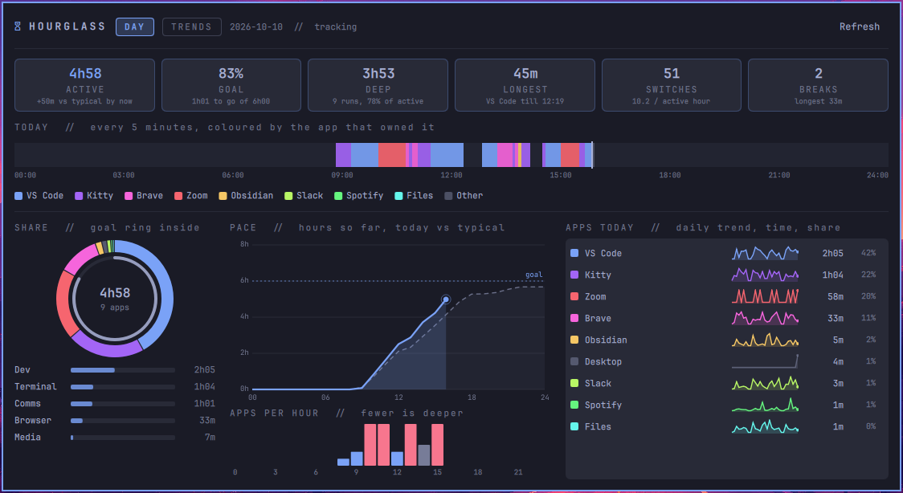
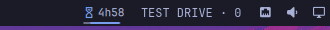
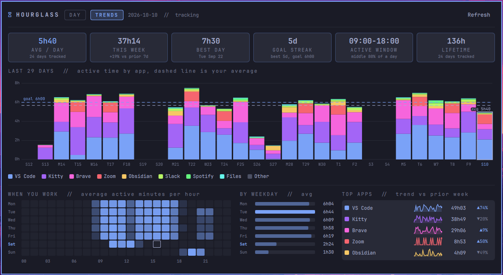

# Hourglass

Screen time for Omarchy. Where did today go, and where did the weeks go?



Hourglass follows which app has focus, sampling every 2 seconds over Hyprland's own socket (no forks, no polling of `hyprctl`). The bar shows today's active time with a thin underline that fills toward your daily goal. Click it for a two-tab panel that fits on one screen and never scrolls (only the app lists scroll, inside their own boxes). Tab, Left/Right, `1` or `2` switch tabs; `r` refreshes; Esc closes.



## DAY

- **Six numbers:** active time (and how far ahead or behind your typical day you are at this same hour), goal progress, deep focus, longest stretch, app switches per active hour, breaks.
- **24h ribbon:** 288 five-minute cells, each coloured by the app that owned it. Hover to see which app.
- **Pace:** today's running total against the average of your earlier days, with the goal line. Hover for the exact gap at any hour.
- **Share ring:** time by app, with a goal ring inside it, and the top categories (Terminal, Browser, Agents, Dev, Comms, Media, System) underneath.
- **Apps per hour:** how scattered each hour was. Fewer is deeper.
- **Apps today:** every app with a 30-day sparkline, time and share.

## TRENDS



- **History:** up to 30 days of stacked bars by app, with your average and goal drawn in. Hover a day for its top apps, switches and deep time.
- **When you work:** a weekday-by-hour heatmap of average active minutes, with a marker on the current hour.
- **By weekday:** average active time per weekday.
- **Top apps:** time over the window, a sparkline and the trend against the prior week.
- **Records:** average per day, this week against the last, best day, goal streak, the hours that hold the middle 80% of your day, lifetime hours.

## How the numbers are made

- **Active:** the screen is unlocked (no `hyprlock`) and within the last 5 minutes the cursor moved or the focused window or its title changed. Time across a suspend is never counted. Set `HOURGLASS_IDLE_SEC` to change the idle window.
- **Deep focus:** 20 minutes or more on one app, back to back, worked out from the per-minute data. Music, video and the bare desktop never count, and neither do they count toward the longest stretch.
- **Typical:** the average of your earlier days at the same time of day.
- **Breaks:** gaps of 5 minutes or more with nothing counted.
- **Active window:** the hours holding the middle 80% of your active time, so night owls get a real answer instead of "00:00 to 23:59".

## Settings

| Setting | Default | What it does |
| --- | --- | --- |
| `goalHours` | 6 | Daily goal. Drives the bar underline, the goal ring and line, and the goal streak. |
| `breakMinutes` | 90 | The glyph pulses after this long without a 5 minute break. 0 turns it off. |
| `refreshSec` | 15 | How often the bar rereads the totals. Tracking samples every 2 s regardless. |
| `showApp` | off | Adds the focused app and its unbroken run beside the total. |

## Privacy

Local only, no network. Only window **classes** are stored (for example `kitty`, `brave-browser`), never titles. Data lives in `~/.local/share/hourglass/YYYY-MM-DD.json`, one small file per day, plus a rebuildable cache (`.summary.json`). Delete them any time.

## Install

```bash
cp -r . ~/.config/omarchy/plugins/nixfred.hourglass
omarchy-shell shell rescanPlugins
omarchy plugin enable nixfred.hourglass
```

The shell service starts `hourglass.py daemon`. It holds a lock, so only one tracker ever runs. After updating the files, `omarchy restart shell` once: a plugin's QML is cached by the running shell and a plain disable/enable keeps the old panel.

```bash
python3 hourglass.py report [days] [goalSeconds]    # the JSON the panel reads
```

## Tested

In Test Drive (Omarchy 4.0.2 plugin checkpoint) first, including the Esc check: with the panel open Esc closes it and the terminal underneath receives nothing, and with the panel closed Esc still reaches the terminal.

## About the screenshots

They are real captures of the real panel from a Test Drive VM, fed with generated demo data (a made-up developer's last four weeks) so that none of the author's own usage, app names or browsing is published. Your own panel fills in from what you actually do.

MIT licensed.
